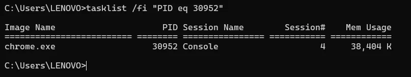
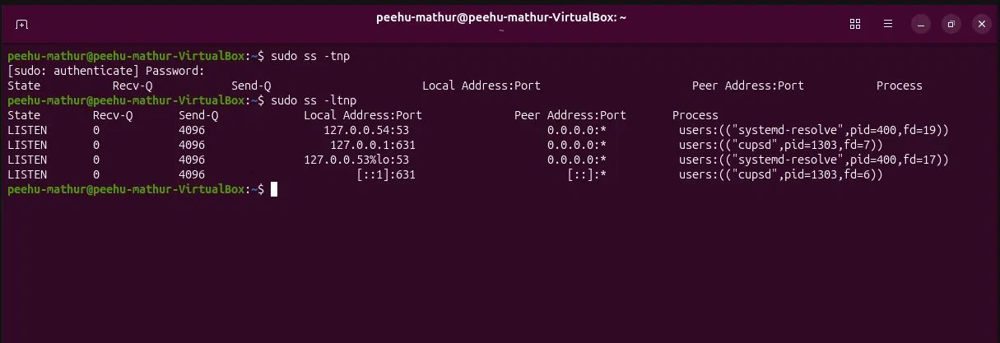
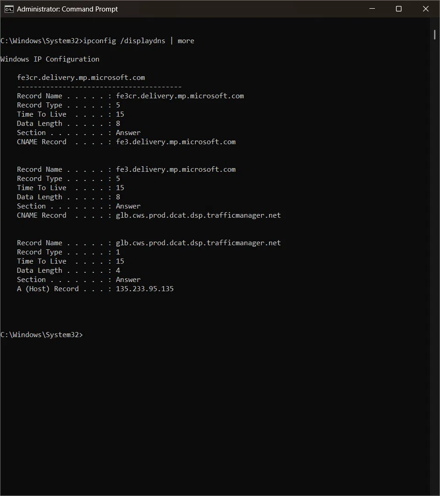

# Day 9: Windows & Linux Networking for Security

## 🎯 Overview
Built host-level network investigation skills — reading active connections,
identifying owning processes, checking DNS cache, and understanding firewall
state. Completed the full chain: remote IP → port → PID → process name →
legitimacy check on both Windows and Linux. Connected host network visibility
to the external packet-capture view from Phase 1.

---

## 🔭 Why Host-Level Network Visibility Matters

Phase 1 gave the external view — packets on the wire via Wireshark.
Day 9 gives the internal view — what the OS itself knows about its
connections, which processes own them, and what can be determined from
the host alone before any SIEM or packet capture is available.

> 🕵️ **First check on a suspected compromised host:** processes (Day 3/6)
> → persistence (Day 4/6) → network connections (today).

---

## 🪟 Windows: netstat

### 🔧 Primary Command
```cmd
netstat -abno
```

| Flag | Meaning |
|---|---|
| `-a` | All connections and listening ports |
| `-b` | Executable owning each connection (requires admin) |
| `-n` | Numeric — don't resolve IPs/ports to names |
| `-o` | Show PID for each connection |

### 🔢 Why -n Matters
- **Speed:** avoids DNS lookup delays
- **Accuracy:** shows actual IPs, not hostnames that can mislead
- **Security:** if DNS is compromised, name resolution returns attacker-controlled values
- Example: without `-n` → `example.com:https`; with `-n` → `93.184.216.34:443`

### 📖 Reading netstat Output

```
Proto  Local Address       Foreign Address       State        PID
TCP    0.0.0.0:445         0.0.0.0:0             LISTENING    4
TCP    192.168.1.10:52341  216.239.32.3:443      ESTABLISHED  30952
```

| State | Meaning |
|---|---|
| LISTENING | Waiting for inbound connections |
| ESTABLISHED | Active connection |
| TIME_WAIT | Connection closing — local side waiting |
| CLOSE_WAIT | Remote closed; local hasn't — process may be hanging |

> ⚠️ **CLOSE_WAIT in large numbers** usually points to an application that
> never closes its sockets after the remote side hangs up — most often a
> software bug. On its own it is not a malware indicator, but a pile-up
> tied to an unfamiliar process is worth a closer look.

### 🔗 Full Investigation Chain
```cmd
# Step 1: Find established connections
netstat -ano | findstr "ESTABLISHED"

# Step 2: Identify process by PID
tasklist /fi "PID eq 30952"

# Step 3: Full path in PowerShell
Get-Process -Id 30952 | Select-Object Path

# Step 4: Hash the binary
Get-FileHash -Path "C:\path\to\process.exe" -Algorithm SHA256
```

### 🧰 Other Key Windows Network Commands

```powershell
# DNS cache — recent domain resolutions (survives after connection closes)
ipconfig /displaydns

# PowerShell — connections with process names inline
Get-NetTCPConnection | Where-Object {$_.State -eq "Established"} |
Select-Object LocalAddress, LocalPort, RemoteAddress, RemotePort,
@{Name="Process";Expression={(Get-Process -Id $_.OwningProcess).Name}} |
Format-Table -AutoSize

# Routing table
route print

# ARP cache
arp -a
```

---

## 🔥 Windows Firewall

Three profiles: Domain / Private / Public

```powershell
# Current state
netsh advfirewall show allprofiles

# All rules
Get-NetFirewallRule | Where-Object {$_.Enabled -eq "True"} |
Select-Object DisplayName, Direction, Action, Profile
```

> 🚨 **SOC alert:** disabled firewall profile or unexpected inbound `Allow`
> rule on a non-server machine. Event ID 4950 (firewall setting changed)
> and 4947 (rule added) in Security log when audit policy is configured.

---

## 🐧 Linux: ss

### 🔧 Primary Commands
```bash
ss -tulpn        # TCP+UDP, listening, process names, numeric
ss -tnp          # Established TCP with process names
ss -ltnp         # Listening TCP only with process names
```

| Flag | Meaning |
|---|---|
| `-t` | TCP |
| `-u` | UDP |
| `-l` | Listening sockets only |
| `-p` | Process name and PID |
| `-n` | Numeric |

### 📖 Reading ss Output
```
State   Local Address:Port    Peer Address:Port   Process
LISTEN  127.0.0.54:53         0.0.0.0:*           systemd-resolve, pid=400
LISTEN  127.0.0.1:631         0.0.0.0:*           cupsd, pid=1303
```

**Loopback binding (`127.x.x.x`)** — service only accessible from
localhost, not exposed to network. Expected for local DNS (port 53)
and printing (port 631).

> 🚨 **Red flag:** unexpected process making outbound ESTABLISHED connection,
> especially from `/tmp`, `/dev/shm`, or interpreted language runtime
> (python3, perl, bash) on a server.

---

## 🗂️ DNS Cache — Forensic Value

DNS cache shows every domain resolved recently, even after the connection
is gone. A C2 domain visited 10 minutes ago still appears.

```cmd
# Windows
ipconfig /displaydns

# Linux (systemd-resolved)
resolvectl statistics            # cache size and hit/miss counts only
journalctl -u systemd-resolved | tail -50
```

> 📝 On Linux, `resolvectl statistics` reports counters, not individual
> domains. Per-domain history usually has to come from resolver logging
> or network-level DNS logs.

### 🔗 CNAME Chains in DNS Cache
`fe3cr.delivery.mp.microsoft.com` → `fe3.delivery.mp.microsoft.com`
→ `glb.cws.prod.dcat.dsp.trafficmanager.net` → `135.233.95.135`

CNAME chaining is also abused in **domain fronting** — malware hides
C2 traffic behind legitimate CDN/cloud infrastructure. A suspicious
CNAME chain resolving to an unexpected final IP is worth investigating.

---

## 📝 /etc/hosts Manipulation

Classic attacker technique — redirect legitimate domain lookups to
attacker-controlled IPs without touching DNS:

```bash
cat /etc/hosts
# Suspicious entry:
# 185.220.101.45 google.com
```

> ✅ Always check `/etc/hosts` during Linux IR.

---

## 🎭 Living off the Land (LotL)

Attackers abuse legitimate built-in OS tools instead of deploying
separate malware — harder to detect because the activity comes from
trusted system utilities.

**Why network-based detection is harder:**
- Connections come from trusted Windows processes (powershell.exe, wmic)
- Traffic resembles normal administrative activity
- No separate malware executable to identify on disk or in network flows

**Two commonly abused Windows tools:**

| Tool | Abuse |
|---|---|
| `powershell.exe` | Download files, execute encoded commands, C2 communication |
| WMI/WMIC | Remote command execution, system enumeration over network (WMIC deprecated in newer Windows; WMI still available) |

> 🔎 **SOC implication:** detecting LotL requires process context (parent-child
> relationships, command-line arguments) not just network signatures.
> `powershell.exe -EncodedCommand` making outbound connections is the
> canonical alert pattern.

---

## 📡 Beaconing Detection Without SIEM

```powershell
# Windows — watch connections across 5 snapshots
for ($i=0; $i -lt 5; $i++) {
    Get-Date; netstat -ano | findstr "ESTABLISHED"; Start-Sleep 60
}
```

```bash
# Linux — equivalent
for i in {1..5}; do date; ss -tnp | grep ESTAB; sleep 60; done
```

Same foreign IP appearing every 60 seconds = beacon pattern confirmed.

---

## 🔬 Practical Evidence

<details>
<summary>🪟 Windows — ESTABLISHED Connection + Process Identified</summary>




**Investigation chain completed:**
- Foreign IP: `216.239.32.3` | Port: `443` | PID: `30952`
- `tasklist /fi "PID eq 30952"` → `chrome.exe` (Console session, 38,404 KB)
- Google Chrome making HTTPS connection — expected activity
- An ESTABLISHED connection on port 443 alone is not suspicious —
  the process identity (`chrome.exe`) and destination IP together
  determine legitimacy
</details>

<details>
<summary>🐧 Linux — Listening Services via ss -ltnp</summary>



Command: `sudo ss -ltnp`

`-l` restricts output to listening sockets, so this view shows exposed
services only; established connections need `ss -tnp`. Listening
services identified:

| Port | Process | Address | Assessment |
|---|---|---|---|
| 53 | systemd-resolve (pid=400) | 127.0.0.54 | Local DNS — expected |
| 631 | cupsd (pid=1303) | 127.0.0.1 | Local printing — expected |
| 53 | systemd-resolve (pid=400) | 127.0.0.53 | Local DNS — expected |
| 631 | cupsd (pid=1303) | [::1] | IPv6 loopback printing — expected |

All services bound to loopback — not exposed to network. Clean baseline.
</details>

<details>
<summary>🔍 Windows — DNS Cache via ipconfig /displaydns</summary>



Command: `ipconfig /displaydns`

**CNAME chain resolved:**
`fe3cr.delivery.mp.microsoft.com`
→ `fe3.delivery.mp.microsoft.com` (CNAME)
→ `glb.cws.prod.dcat.dsp.trafficmanager.net` (CNAME)
→ `135.233.95.135` (A record)

Both domains are Microsoft content-delivery and traffic-management
infrastructure — consistent with Windows Update or Microsoft Defender
telemetry. Expected activity on a Windows machine.

**SOC note:** CNAME chains are also used in domain fronting attacks —
malware hides C2 traffic behind legitimate CDN infrastructure. A
suspicious final IP in an otherwise-legitimate-looking CNAME chain
is worth correlating against threat intelligence.
</details>

---

## 💡 Key Takeaways
- Always use `-n` (numeric) in netstat/ss during investigations —
  avoids DNS delays and manipulation of name resolution
- The full investigation chain is: connection → PID → process name →
  executable path → hash → legitimacy check
- DNS cache (`ipconfig /displaydns`) shows recent domain resolutions
  even after connections have closed — forensic goldmine
- Loopback-bound services (127.x.x.x) are not exposed to the network
  — binding address matters as much as port number
- LotL attacks abuse trusted built-in tools — detection requires
  process context (who spawned what, with what arguments) not just
  network signatures
- Beaconing can be confirmed without a SIEM by taking repeated
  netstat/ss snapshots and looking for the same foreign IP appearing
  at regular intervals
