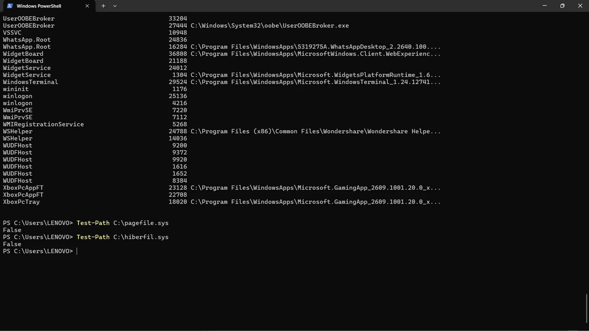
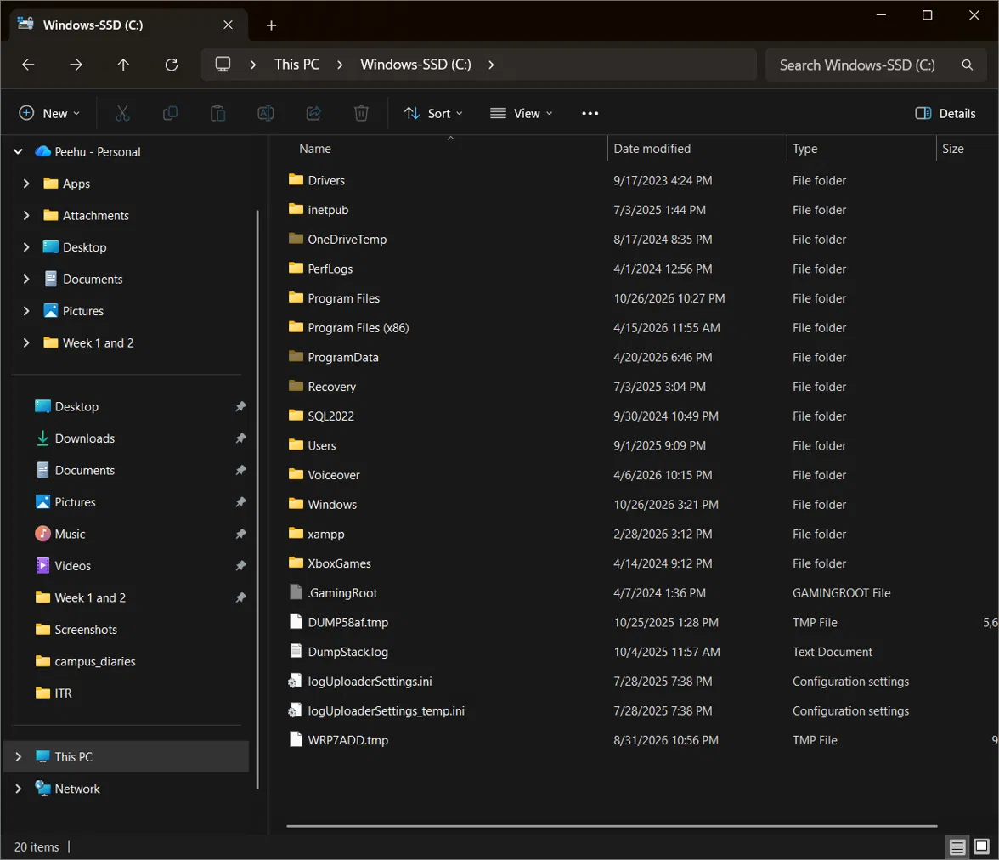
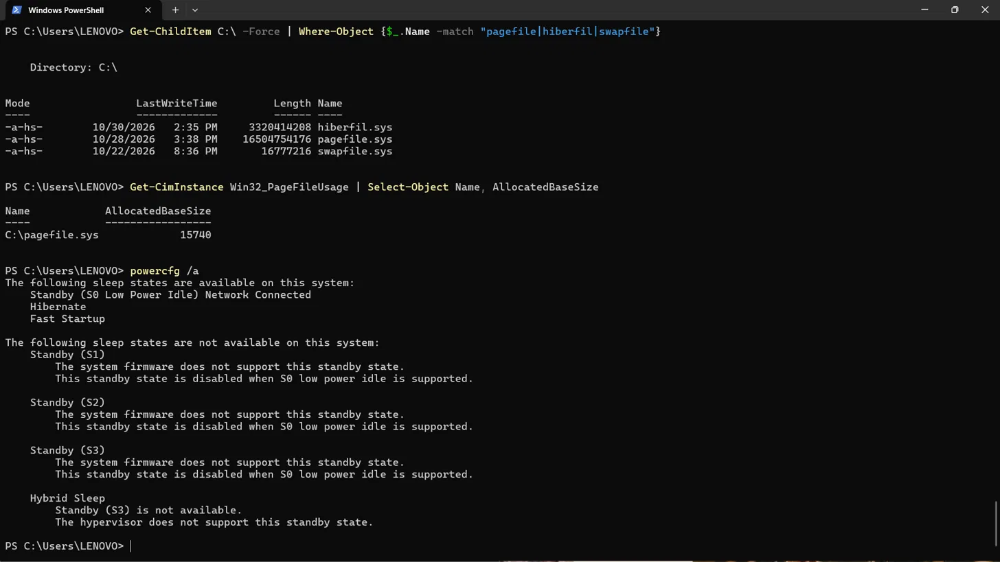
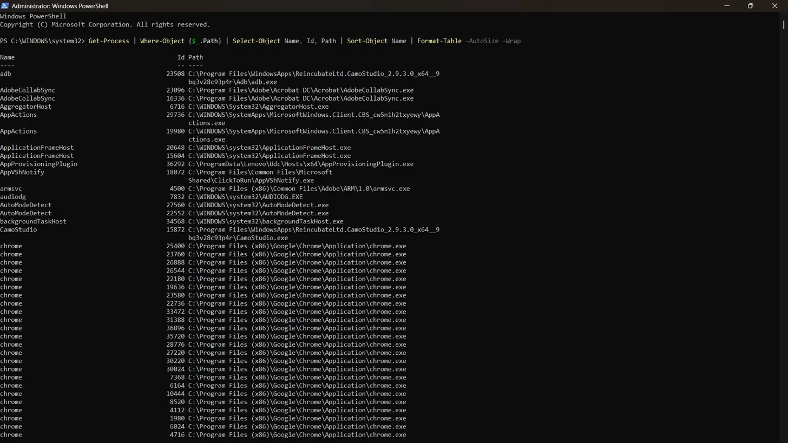

# 🧠 Day 10: Memory Forensics Basics

## 🎯 Overview
Studied what exists only in RAM, how memory is acquired and analysed, and
why attackers favour memory-resident techniques. Verified the on-disk memory
artefacts (pagefile, hibernation file) on a live Windows system and learned
a methodology lesson: a null result only counts if the method could have
detected the thing.

---

## 🔬 Why Memory Forensics Is Different

Logs rotate, registry keys persist, files sit on disk. RAM exists only while
the machine is powered on and is constantly overwritten. Process injection
(Day 3), fileless malware, and encoded PowerShell (Day 9) live primarily or
entirely in memory — so memory forensics is a distinct skill.

---

## 🗺️ What Lives in a Process's Memory

| Region | Forensic value |
|---|---|
| Executable image | Original code — or, in process hollowing, the malicious replacement |
| Heap | Decrypted strings, C2 addresses, credentials never written to disk |
| Stack | Recent function calls and arguments |
| Loaded DLLs | Legitimate or injected malicious libraries |
| Environment / arguments | Command line, environment variables |

---

## 💾 On-Disk Memory Artefacts

### 🪟 Windows
| File | Purpose | Forensic significance |
|---|---|---|
| `pagefile.sys` | Pages memory out of RAM under pressure | "Memory-only" content may be written to disk indirectly |
| `hiberfil.sys` | Hibernation / Fast Startup data | Persists after power-off |
| `swapfile.sys` | Memory management for modern app processes | Small supporting swap file |

**Pagefile mechanism:** malware that never writes its payload to disk can still
leave fragments on disk, because Windows moves memory pages to `pagefile.sys`
under memory pressure. Recoverable fragments include code, scripts,
credentials, and decoded commands.

> 💡 **Hibernation nuance:** a full hibernate writes RAM contents to `hiberfil.sys`.
> With **Fast Startup**, the file instead captures the kernel session and
> drivers, not full user-mode process memory — still analysable, but less
> complete than a full hibernation image.

### 🐧 Linux equivalents
- Swap partition or `/swapfile` — same concept as the pagefile
- `/proc/<PID>/mem` — live process memory (permissions required)

---

## 📥 Memory Acquisition

Memory cannot be copied like a file; it needs a tool that reads physical memory.

| Platform | Tools |
|---|---|
| Windows | WinPmem, DumpIt, FTK Imager |
| Linux | LiME (kernel module), `/proc/kcore` (limited) |

**Output:** `.raw` (flat physical memory) or `.dmp`, both analysable with
Volatility.

> 🚨 **Critical IR principle:** capture first, investigate second. Running tools
> overwrites memory pages. **Never reboot a suspected-compromised machine until
> memory has been acquired.**

---

## 🛠️ Volatility

Industry-standard open-source memory forensics framework.

```bash
vol.py -f memory.raw windows.pslist      # Processes via the kernel's linked list
vol.py -f memory.raw windows.pstree      # Parent-child relationships
vol.py -f memory.raw windows.psscan      # Scan memory for EPROCESS structures
vol.py -f memory.raw windows.netstat     # Connections at capture time
vol.py -f memory.raw windows.cmdline     # Command lines for all processes
vol.py -f memory.raw windows.dlllist --pid 4444
vol.py -f memory.raw windows.malfind     # Injected executable memory regions
vol.py -f memory.raw windows.procdump --pid 4444 --dump-dir ./output/
```

### 🔑 Key Plugins

**`pslist` vs `psscan` — hidden process detection**
- `pslist` walks the kernel's `ActiveProcessLinks` list
- `psscan` scans physical memory for `EPROCESS` structures by signature,
  regardless of linking
- A process in `psscan` but not `pslist` is one of: a hidden process
  (DKOM unlinking, a rootkit indicator), or a terminated process whose
  structures remain in memory. Further investigation is required to tell which.

**`malfind` — injected code detection**
Finds memory regions that are executable, not backed by any file on disk, and
contain code-like content (MZ header or shellcode patterns). This is how
injection and hollowing (Day 3) are detected in memory.

**`cmdline` / `dlllist`** — a legitimate-looking process can still reveal
compromise through its arguments (e.g. `svchost.exe` with no `-k`) or an
unexpected DLL loaded from `C:\Temp\`.

### 🔄 Volatility 2 vs Volatility 3
| | Volatility 2 | Volatility 3 |
|---|---|---|
| OS identification | Analyst manually selects a **profile** | Automatic, using symbol tables |
| What it relies on | Profile = kernel symbols, structures, and offsets for a specific OS build | ISF (Intermediate Symbol Format) files, with Windows symbols resolved from Microsoft's symbol servers |

Different OS versions and architectures have different memory layouts, so a
wrong profile gives wrong or no results.

---

## ⚖️ Disk vs Memory Forensics

| Evidence | Disk | Memory |
|---|---|---|
| Fileless malware payload | ❌ Never written | ✅ In memory regions |
| Decrypted strings / C2 addresses | ❌ Encrypted at rest | ✅ Decrypted in heap |
| Process injection | ❌ No file to find | ✅ `malfind` |
| Credentials in LSASS | ❌ Hashed on disk | ✅ Present in LSASS memory |
| Live connections | ❌ Logs may be cleared | ✅ `netstat` plugin |
| Hidden processes | ❌ Not in logs | ✅ `psscan` vs `pslist` |

---

## 🕵️ Host Investigation: Process → Path → Legitimacy

```powershell
# Run as Administrator — non-elevated sessions return blank paths
# for protected processes
Get-Process | Where-Object {$_.Path} | Select-Object Name, Id, Path |
Sort-Object Name | Format-Table -AutoSize -Wrap

# Second check beyond path: publisher signature
Get-AuthenticodeSignature "C:\path\to\process.exe" |
Select-Object Status, SignerCertificate
```

**Investigating a PowerShell process owning an ESTABLISHED connection:**
1. Identify the remote IP and check its reputation
2. Check the **parent process** — who spawned it often tells the most
   (`winword.exe` → `cmd.exe` → `powershell.exe` vs `explorer.exe` → `powershell.exe`)
3. Check command line and execution path
4. Review PowerShell logs, security events, and network activity

> ✅ Path is the strongest single check but not proof; signature, publisher, and
> behaviour add confidence.

---

## 🔬 Practical Evidence

<details>
<summary>🪟 Get-Process — Executable Paths (Administrator)</summary>



Run elevated, nearly every `Path` resolved. Two processes assessed:

**`chrome` (PID 25400)** — `C:\Program Files (x86)\Google\Chrome\Application\chrome.exe`
- Legitimate: path matches the Chrome install directory
- Dozens of instances is normal (one process per tab/extension); the signal is
  that every instance shares the same path
- Suspicious would be: `chrome.exe` running from `AppData` or `Temp`

**`AppProvisioningPlugin` (PID 36292)** — `C:\ProgramData\Lenovo\Udc\Hosts\x64\AppProvisioningPlugin.exe`
- Consistent with Lenovo software; corroborated by the Lenovo UDC scheduled
  tasks observed on Day 4
- `ProgramData` is a location malware commonly abuses, so signature and
  publisher verification would add confidence
- Suspicious would be: an invalid signature, unexpected publisher, or
  unexpected network activity

Blank `Path` fields in a non-elevated session are a session limitation, not a
finding.
</details>

<details>
<summary>⚠️ Test-Path — False Negative (Methodology Lesson)</summary>



`Test-Path C:\pagefile.sys` and `Test-Path C:\hiberfil.sys` both returned
`False`. This was **not** a real absence: both are hidden, protected system
files that `Test-Path` does not reliably report without `-Force`. A null
result only counts if the method could have detected the thing — the same
discipline as the failed-password searches on Day 8.
</details>

<details>
<summary>✅ Corrected Verification — Three Independent Methods</summary>



```powershell
Get-ChildItem C:\ -Force | Where-Object {$_.Name -match "pagefile|hiberfil|swapfile"}
Get-CimInstance Win32_PageFileUsage | Select-Object Name, AllocatedBaseSize
powercfg /a
```

| File | Mode | Size | Last write |
|---|---|---|---|
| `hiberfil.sys` | `-a-hs-` | ~3.09 GB | 10/30/2026 2:35 PM |
| `pagefile.sys` | `-a-hs-` | ~15.4 GiB | 10/28/2026 3:38 PM |
| `swapfile.sys` | `-a-hs-` | 16 MB | 10/22/2026 8:36 PM |

- `Win32_PageFileUsage` reports `C:\pagefile.sys` at 15,740 MB, matching the file length
- `powercfg /a` confirms Hibernate and Fast Startup are available
- The `hs` attributes (hidden + system) explain why the files were invisible earlier
- `hiberfil.sys` was rewritten on 10/30 — consistent with Fast Startup rewriting
  it on shutdown
</details>

<details>
<summary>📁 C:\ Root — File Explorer View</summary>



"Show hidden items" is enabled (dimmed folders such as `ProgramData`, `Recovery`
are visible), but `pagefile.sys` and `hiberfil.sys` do not appear. They are
**protected operating system files**, which stay hidden until "Hide protected
operating system files" is also unticked. Same lesson: the view could not have
shown them, so their absence from it is not evidence.
</details>

---

## 🧑‍💻 SOC Relevance

A Tier-1 analyst rarely runs full memory forensics, but must:
1. **Know when to request a memory capture** — fileless malware, injection,
   or suspected rootkit indicators
2. **Escalate before reboot** — rebooting destroys evidence disk forensics
   can't recover
3. **Read DFIR output** — understand what `psscan`/`malfind` results mean
4. **Remember clearing logs doesn't clear memory** — pagefile and hibernation
   data may retain evidence after tampering

## 🔗 Connections to Earlier Days
- **Day 2:** Mimikatz reads LSASS memory — offensive memory forensics
- **Day 3:** `malfind` detects process injection and hollowing
- **Day 4:** persistence may already have executed into a running process
- **Day 9:** Volatility's `netstat` shows connections that existed at capture,
  even if the attacker later cleared logs

## 💡 Key Takeaways
- RAM holds evidence disk forensics cannot reach: fileless payloads, decrypted
  strings, injected code, hidden processes
- `psscan` vs `pslist` is the hidden-process test; `malfind` is the injection test
- The pagefile lets "memory-only" malware leave fragments on disk indirectly
- With Fast Startup, `hiberfil.sys` is a partial image, not full RAM
- Capture memory first, investigate second — never reboot a suspect machine first
- A null result is only evidence if the method could have found the thing;
  verify with independent methods before concluding something is absent
